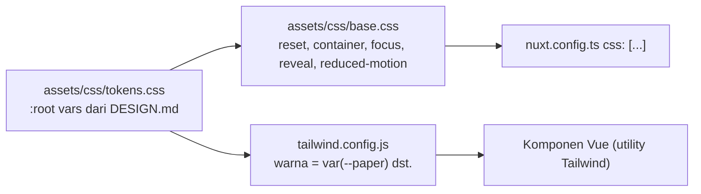

# Redesign Landing Page → Sanggar Indah Palastri

## Goal
Situs yang sekarang adalah landing **Sanggar Indah Parahyangan** (Nuxt 3 + Tailwind, tema forest/gold). Target:
1. Ganti identitas jadi **Sanggar Indah Palastri**.
2. Redesign visual mengikuti [DESIGN.md](file:///c:/Users/Salivs/Data/laragon/www/landingpage-sip/docs/design/DESIGN.md) dan [DESIGN.html](file:///c:/Users/Salivs/Data/laragon/www/landingpage-sip/docs/design/DESIGN.html): Natural Scandinavian × Modern Editorial, sage green + warm neutral, DM Sans + Fraunces, 10 section.
3. CSS dirombak total. Semua teks dan data di `data/content.js`.

## Temuan riset
| Temuan | Dampak |
|---|---|
| `tokens.css` dan `base.css` di root berisi tema **dark indigo**, tidak diimpor di mana pun (`nuxt.config.ts` tidak punya `css:`). `app.vue` sudah merujuk `var(--color-paper)` yang tidak terdefinisi. | Sisa sesi lama. Diganti total, dipindah ke `assets/css/`, lalu dipasang lewat `css:`. |
| `tailwind.config.js` masih palet forest/orange/charcoal + resep gradasi tombol emas/oranye. | Ditulis ulang. Warna jadi CSS var Palastri. |
| 20 komponen masih memakai kelas `bg-forest-deep`, `text-orange`, `grad-gold`, dan sejenisnya. | Semua kelas lama diganti. |
| Teks, klaim, dan aset khusus Parahyangan tersebar di `content.js` (KBP, IKEA, Whoosh, Tol Padalarang, harga 160–300 jt, cicilan 1 jutaan, hero + signage, peta, maskot, kantor KBP, Instagram). | Dibuang atau ditulis ulang. DESIGN.md melarang klaim dan foto proyek lain. |
| `content.js` sudah mencatat Palastri (2019, Arjasari, Kab. Bandung). Cocok dengan alamat di DESIGN.md. | Alamat "Mangunjaya, Arjasari, Kabupaten Bandung" dipakai. |
| Foto kamu sudah ada di `public/assets/images/palastri/`: `sip 2260.png`, `sip 2260 denah.jpg`, `sip 3172.jpg`, `sip 3172 denah.jpg`. Logo ada di `public/assets/images/logo-palastri.png`. | Nama file dirapikan di Fase A. |
| Kualitas foto: `sip 2260.png` hanya 643 px dan punya pita putih di kiri. `sip 3172 denah.jpg` hanya ±300×430 px. | Pita putih di-crop. Denah 31/72 akan buram di lightbox. Mohon kirim versi lebih besar. |
| `gsap` hanya dipakai di `LoadingScreen` dan marquee penghargaan di `AboutSection`. | Dipertahankan di dua tempat itu. Reveal baru memakai `IntersectionObserver` native sesuai DESIGN.md. |
| Backend/Supabase (`docs/backend/`) belum ada kodenya. | Di luar scope. `backend-agent` tidak dipakai. |

## Keputusan user
- Konten: draft DESIGN.md. Tipe jadi **2**: **22/60 Subsidi** dan **31/72 Komersial**. Tanpa harga. Data di `content.js`.
- Semua fitur lama dipertahankan, hanya tampilan yang diganti: modal tipe + galeri fasad + lightbox, KPR (strip + modal), Member Get Member, sambutan referral, loading screen, tombol WhatsApp melayang, carousel penghargaan/proyek di FAQ.
- Form: pipeline lama (reCAPTCHA + Apps Script + Sheet). Endpoint dan key baru dari kamu menyusul.
- Foto: tipe dari kamu. Hero, Tentang, dan Lokasi memakai foto Unsplash dari mockup sebagai placeholder, diunduh lokal.
- Kontak: nomor WA, email, dan alamat kantor SIG tetap. Domain/CNAME tidak diubah. Instagram dan TikTok Parahyangan dihapus. Lokasi memakai tombol Buka Google Maps (pencarian).

## User Review Required

> [!WARNING]
> **Leads Palastri akan masuk ke Sheet dan reCAPTCHA milik Parahyangan** sampai kamu memberi endpoint dan key baru. Default-nya masih tertanam di `nuxt.config.ts`. Untuk membedakan, field `source` diganti `landing-page-palastri`. Ini memengaruhi Apps Script jika ia memfilter `source`.

> [!WARNING]
> **Domain tetap `sanggarindahparahyangan.com`.** Canonical, `og:url`, dan `og:image` akan menunjuk ke domain itu sampai ada domain Palastri.

> [!IMPORTANT]
> **Dua klaim yang belum terverifikasi (default saya, mohon dikoreksi):**
> 1. **Spesifikasi bangunan** (pondasi batu kali, dinding hebel, dan seterusnya) berasal dari Parahyangan. Default: **dikosongkan** dan bagian spesifikasi di modal disembunyikan sampai kamu mengirim data Palastri.
> 2. **Penghargaan SIG, "30+ tahun", dan daftar proyek SIG** adalah data level grup. Default: **tetap tampil** di Tentang dan FAQ, tanpa angka di hero atau trust strip. DESIGN.md melarang angka pengalaman tanpa data resmi, jadi mohon konfirmasi.

> [!NOTE]
> Kamar tidur 22/60 dibaca dari denahmu: 1 kamar + ruang "bisa dikembangkan menjadi R. Tidur 2". 31/72: 2 kamar, 1 KM. Mohon cek.

> [!NOTE]
> Logo resmi (merah + hijau lime) dipakai apa adanya, tanpa diubah warnanya, di header, footer, dan loading screen. Merah tidak dipakai di elemen UI lain, supaya palet sage tetap bersih.

## Arsitektur CSS (rombak total)

- `tokens.css`: `--paper #F6F5EF`, `--paper-deep`, `--white`, `--ink`, `--muted`, `--green #536B55`, `--green-deep`, `--green-soft`, `--sage-pale`, `--sand`, `--line`, `--radius 22px`, `--shadow`, `--serif` (Fraunces), `--sans` (DM Sans).
- `base.css`: container `min(1180px, 100% - 64px)` dengan breakpoint 900/680/380, `scroll-padding-top: 88px`, `:focus-visible`, `.reveal` + `.is-visible`, `prefers-reduced-motion`, kelas `eyebrow`, `serif`, `btn`, `btn-primary`, `btn-outline`, `text-link` yang dibagi banyak komponen.
- Utility Tailwind tetap dipakai (konvensi repo). Kelas yang dipakai berulang (btn, eyebrow) dibuat sekali di `base.css`.
- Font: link Google Fonts di `nuxt.config.ts` diganti ke DM Sans + Fraunces. Be Vietnam Pro dan Cormorant dibuang.
- `.hero-*`, `signage`, dan resep `grad-*` dihapus bersama komponennya.

## Pembagian fase
Tiap fase = 1 task `frontend-agent` → `qa-agent` (build + Playwright 375/768/1280, console bersih) → lanjut. Fase F memakai `doc-agent`. Urutan A → E wajib berurutan.

| Fase | Isi | File utama |
|---|---|---|
| **A. Fondasi** | CSS baru, Tailwind, font, `content.js` baru, aset, SEO, loading screen | lihat bawah |
| **B. Header + Hero + Trust** | Header sticky + menu mobile, hero split editorial, trust strip, strip KPR | `TheHeader`, `HeroSection`, `[NEW] TrustStrip`, `KprPartnerStrip`, `pages/index.vue` |
| **C. Tentang + Pilihan Rumah + Kenapa** | About foto asimetris, 2 kartu tipe + modal + galeri + lightbox, daftar bernomor | `AboutSection`, `ProductsSection`, `HouseTypeModal`, `FacadeGallery`, `Lightbox`, `ReasonsCardsSection` → `WhySection` |
| **D. Lokasi + FAQ + Kontak + Footer** | Panel lokasi + peta, accordion bergaris, CTA hijau + form inline, footer | `[NEW] LocationSection`, `FaqSection`, `FaqItem`, `FinalCtaSection`, `TheFooter` |
| **E. Floating WA + modal + cleanup** | Reskin tombol WA, modal KPR/MGM/Referral, hapus aset dan kode Parahyangan yang yatim | `WhatsAppFloatingButton`, `KprTermsModal`, `MemberGetMemberModal`, `ReferralWelcomeModal` |
| **F. QA penuh + Docs** | Regresi total, Lighthouse, update progress dan spec | `docs/progress.md`, `docs/superpowers/specs/` |

### Fase A — Fondasi
- **[DELETE]** `tokens.css`, `base.css` (root, sisa dark indigo, tidak terpakai).
- **[NEW]** `assets/css/tokens.css`, `assets/css/base.css`.
- **[MODIFY]** `tailwind.config.js`: palet baru, `fontFamily.display = Fraunces`, `body = DM Sans`. Hapus `grad-*`, `btn-*` shadow, `floatPulse`. Radius dan shadow dari token.
- **[MODIFY]** `nuxt.config.ts`: `css: ['~/assets/css/tokens.css', '~/assets/css/base.css']`, link font baru. Keys Sheet/captcha **tidak diubah**.
- **[MODIFY]** `app.vue`: hapus blok style body lama (pindah ke `base.css`), sisakan fix z-index reCAPTCHA.
- **[MODIFY]** `data/content.js` — ganti seluruh teks:
  - `meta`: `projectName 'Sanggar Indah Palastri'`, `logo '/assets/images/logo-palastri.png'`, `tagline 'Rumah pertama, cerita baru'`, hapus `priceFrom`. Nav: Tentang Kami, Pilihan Rumah, Keunggulan, FAQ + CTA Konsultasi.
  - `hero`, `trust` (3 poin), `about`, `why` (4 poin), `location` (alamat + query Google Maps), `faqs` (5 pertanyaan DESIGN.md + penghargaan + proyek SIG), `contactCta`, `footer`.
  - `houseTypes`:
    ```js
    { id: '22-60', name: 'Tipe 22/60', lb: '22', lt: '60', kt: '1', km: '1', tag: 'Subsidi',
      thumbnail: '/assets/images/palastri/rumah/2260-3d.webp',
      gallery: ['/assets/images/palastri/rumah/2260-denah.webp', '/assets/images/palastri/rumah/2260-3d.webp'],
      facades: [{ src: '.../2260-3d.webp', label: 'Perspektif' }], specsOverride: [] },
    { id: '31-72', name: 'Tipe 31/72', lb: '31', lt: '72', kt: '2', km: '1', tag: 'Komersial', /* sama, 3172-* */ }
    ```
  - Hapus: `locations`, `oneGate`, `installment`, `advantages`, `mascot`, `reasons`, `stats`, harga di `products`, `defaultSpecs` (jadi `[]`).
  - `projects.items`: `current: true` pindah ke Palastri. Instagram dan TikTok dihapus.
  - `memberGetMember.disclaimer` dan teks "SIPAR" → Palastri.
- **[MODIFY]** `composables/useContent.js`: buang pemetaan `advantages`, `hero.imageMobile`, `locationSection.mapImage` yang sudah tidak ada. `withBase` tetap.
- **[MODIFY]** `pages/index.vue`: SEO meta dari DESIGN.md §9 (title "Sanggar Indah Palastri — Rumah untuk Cerita Baru"), `og:image` memakai foto hero.
- **[MODIFY]** `BaseButton.vue`, `Badge.vue`, `LoadingScreen.vue`: pill hijau dan warna baru.
- **Aset:** rapikan `public/assets/images/palastri/` menjadi `rumah/2260-3d.webp`, `2260-denah.webp`, `3172-3d.webp`, `3172-denah.webp` (crop pita putih 2260, konversi WebP jika `sharp` tersedia). Unduh 4–5 foto Unsplash dari mockup ke `palastri/` sebagai `hero`, `about-main`, `about-detail` (placeholder, dicatat di docs).

### Fase B–E (ringkas)
- **B:** Header 76/67 px, blur, logo gambar + sub-label "by Sanggar Indah Group", menu mobile (`aria-expanded`, tutup setelah klik). Hero: grid 0.88fr/1.12fr, h1 Fraunces ≤83 px "Rumah pertama, cerita baru.", foto arch 535 px, stamp, kartu melayang. Angka `01 / 03` **dihapus** (tidak ada carousel). Trust strip 3 poin. Strip KPR BCA/BTN dipertahankan, dibuat tipis di bawah trust strip.
- **C:** About: foto utama + inset overlap + badge `01 / Awal cerita`. Carousel penghargaan dipertahankan sebagai strip tenang. Pilihan Rumah: 2 kartu besar (Subsidi, Komersial) dengan foto dominan, tanpa harga, tombol **Lihat Detail** membuka `HouseTypeModal` (denah + 3D + galeri) dan **Diskusikan** membuka WA. Kenapa Palastri: intro sticky + daftar bernomor 4 poin.
- **D:** Lokasi: panel dua kolom, alamat, tombol **Buka Google Maps** (`maps.google.com/?q=Mangunjaya Arjasari Kabupaten Bandung`), tanpa peta CSS palsu dan tanpa klaim jarak. FAQ: accordion bergaris, 1 item terbuka, `aria-expanded`. Kontak: panel hijau, form inline (nama, WA, kebutuhan) memakai `useConsultationForm` (reCAPTCHA + Sheet). Footer `#26382E`, 3 kolom, tahun copyright dinamis.
  > [!NOTE]
  > Risiko: `useConsultationForm` dirancang untuk satu widget reCAPTCHA di modal. Form inline dan modal MGM bisa berebut widget. Builder wajib menguji. Fallback: inline form memakai instance composable sendiri, atau tombol membuka modal yang sama.
- **E:** Reskin tombol WA melayang dan 3 modal. `source` jadi `landing-page-palastri`. Hapus yang yatim akibat perubahan ini saja: `ReasonsCardsSection`, `hero*.webp`, `signage*`, `signgate`, `fasilitas/*`, `rumah/*`, `petalokasi-v2`, `kenapa`, `mascot`, `logo.webp`, `proyek-timeline` **tetap**, logo SIG, penghargaan, dan bank **tetap**.

## Format task (contoh Fase A; B–E mengikuti pola yang sama)
```text
Task ID      : Fase A - Fondasi Palastri
Role         : frontend-agent
Baca Skill   : .agents/skills/frontend-agent/SKILL.md
Baca Dokumen : docs/design/DESIGN.md, docs/design/DESIGN.html, docs/progress.md, rencana ini
Kerjakan     : daftar "Fase A" di atas
Selesai Jika :
  - npx nuxi generate lulus tanpa warning kritis
  - Given halaman dibuka, When inspeksi body, Then font DM Sans, background #F6F5EF, tidak ada var() tak terdefinisi
  - grep "forest-|grad-gold|Parahyangan|SIPAR|KBP|IKEA" di components/ dan data/ → 0 hasil di teks UI
  - houseTypes hanya 2 (22/60 Subsidi, 31/72 Komersial), semua path gambar 200 OK
Larangan     : jangan ubah nuxt.config sheetEndpoint/captchaSiteKey; jangan sentuh logika composable selain pemetaan konten; jangan pasang dependensi baru
```

## Verifikasi
**Otomatis (qa-agent):** `npx nuxi generate`; Playwright di 375/390, 768, 1280 untuk header + menu mobile, smooth scroll dengan anchor tidak tertutup header, buka modal tipe + galeri + lightbox, FAQ satu terbuka dengan keyboard, form kontak (validasi + status sukses/error), tombol WA dan modal MGM/KPR, tanpa horizontal overflow, tanpa console error atau 404, `prefers-reduced-motion` aktif → konten tetap tampil, Lighthouse Performance dan SEO ≥ 90.

**Manual (kamu):** konfirmasi tiga item di *User Review Required*, kirim endpoint/key Palastri, foto hero asli, dan foto resolusi lebih tinggi (22/60 3D, 31/72 denah). Lalu cek visual terhadap `DESIGN.html`.

## Catatan teknis
- Working tree saat ini kotor (perubahan `DESIGN.*`, CRLF di banyak komponen). Setelah kamu setuju, saya buat branch `redesign-palastri` sebelum Fase A supaya Parahyangan tetap utuh di riwayat git.
- Subagent dipakai sesuai orkestrator: `frontend-agent` (A–E), `qa-agent` (tiap fase), `doc-agent` (F). Tidak ada kode yang saya tulis langsung.
